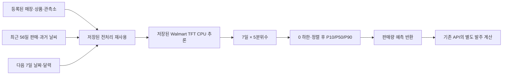

# 기존 Walmart TFT 발표용 설명

이 자료는 **기존 Walmart TFT와 미국 Walmart의 2012~2014년 판매·기상 자료를 사용한 과거 재현**을 설명한다. 한국 매장의 현재 수요나 당시 실제 일기예보를 검증한 결과로 소개하지 않는다. 서버 연결·Ubuntu 검증은 팀원 측에서 완료한 것으로 전달받았으며 이 자료의 범위는 모델 설명과 평가 근거다.

[일반 매장용 `merchant_tft`](../merchant_tft/README.md)는 합성 자료로 학습하고 실제 예보를 입력받는 별도 TFT다. 아래 **6.98%·10.71% 및 동일 환경 3개 seed 실험은 모두 Walmart 모델·자료의 결과**이며 `merchant_tft`에 적용할 수 없다. 합성 모델의 실매장 정확도와 실제 예보 효과는 미검증이고, 해당 모델의 작업은 이번 PR 범위 밖이다.

## 60~90초 설명 대본

> 기존 Walmart 모델은 매장과 상품별로 최근 56일의 판매 기록을 보고, 다음 7일의 일별 판매량을 예측합니다. 매장·상품 정보, 과거 판매와 날씨, 앞으로 알 수 있는 달력 정보를 함께 다루고 여러 날짜를 예측하기에 적합한 구조로 TFT를 선택했습니다.
>
> 결과는 숫자 하나만 보여주지 않습니다. 낮은 쪽, 중앙, 높은 쪽의 분위수를 함께 반환해 예측의 폭을 볼 수 있게 했습니다. 다만 이 구간이 매번 정확히 맞는다는 보장은 아닙니다. 판매 기록의 0과 기록 누락도 구분하며, 56일의 관측이 부족하면 임의 예측 대신 이력 부족을 반환합니다.
>
> 미국 과거 자료에서 선택한 200개 매장·상품 조합, 같은 테스트 7,973행을 비교했을 때 기존 API의 요일 기준선보다 평균 절대오차가 6.98% 낮았습니다. 이 결과를 모든 상품이나 한국 매장에 일반화하지는 않습니다.
>
> 이 Walmart 모델의 미래 날씨는 마지막 관측값을 유지하는 방식입니다. 별도 합성 모델은 실제 예보 입력을 받지만 실매장 정확도와 예보 효과는 아직 검증하지 않았습니다. 모델이 제공하는 것은 판매량 예측이고, 재고와 납기를 반영한 발주 계산은 기존 API가 담당합니다.

발표 속도에 따라 길이를 조절한다. 이 대본의 6.98%는 원본 A100 모델과 API의 비교다. 첫 숫자 슬라이드에는 아래 평가 조건을 함께 표시한다. 10.71%를 발표하려면 전체 결과와 구분해 부분집합 조건을 읽는다. 같은 환경의 날씨 효과 질문에는 아래 완료된 3개 seed 결과로 답한다.

## 기존 Walmart 모델이 받는 것과 반환하는 것

| 구분 | 실제 구현 |
| --- | --- |
| 대상 | 저장된 대응표의 매장·상품 조합. 매장과 관측소의 대응도 검사한다. |
| 과거 입력 | 기준일까지 연속 56일의 관측 판매 개수와 기온·강수·풍속 및 결측 표시. 관측된 판매 0은 유효하다. |
| 달력 입력 | 날짜 인덱스, 요일·월·주말·연간 주기. `time_idx`의 원점은 2012-01-01이다. |
| 미래 날씨 | 마지막 과거 날씨 특징을 7일간 유지하는 persistence. 미래 실측이나 실제 발급 예보를 넣은 평가가 아니다. |
| 모델 출력 | 날짜마다 `[P10, P25, P50, P75, P90]`. 판매 개수 예측이며 소수일 수 있다. |
| API용 반환 | 음수를 0으로 제한하고 다섯 값을 정렬한 뒤 인덱스 `0·2·4`를 `p10·p50·p90`으로 선택한다. point의 필드는 `date,p10,p50,p90`뿐이다. |
| 실패 처리 | 누락된 판매 이력·미등록 조합은 `insufficient_history`와 빈 예측. 잘못된 관측소 대응·중복/비정상 입력은 오류다. |
| 요청 중 실행 | 체크포인트와 저장된 인코더·스케일러를 재사용한다. 요청마다 학습하거나 통계를 다시 fit하지 않는다. |

근거: [추론 함수](../predict.py), [전처리](../preprocess.py), [입력·출력 규격과 실행 방법](../README.md), [학습 대상 대응표](../metadata/selected_series.csv).

## 왜 TFT인가

TFT는 고정된 식별 정보, 과거에만 관측되는 시계열, 미래에 알 수 있는 입력을 함께 다루는 다중 시점 예측 구조다. 순환 계층과 attention을 결합하는 설계가 이 문제의 입력 형태와 맞는다. 이는 구조 선택의 근거이며 이 프로젝트에서 모든 다른 모델을 이겼다는 증거는 아니다. [TFT 원 논문](https://arxiv.org/abs/1912.09363)

| 설계상 선택 이유 | 이 프로젝트에서 확인한 범위 | 아직 말할 수 없는 것 |
| --- | --- | --- |
| 여러 종류의 입력을 한 모델에 넣는다. | 학습 코드에서 매장·상품·관측소, 달력, 판매·날씨를 구분해 정의했다. | 모든 입력이 도움이 된다는 주장. |
| 다음 7일을 같은 모델로 예측한다. | encoder 56일, horizon 7일로 학습하고 날짜별 분위수를 반환한다. | 56일이 최적의 이력 길이라는 주장. |
| 중앙값과 예측 폭을 함께 제공한다. | 5개 분위수의 quantile loss로 학습했다. | 정렬된 분위수가 완벽히 보정되었다는 주장. |
| 기존 동작과 성능을 비교할 수 있다. | 현재 API 요일 기준선과 같은 테스트 행에서 비교했다. | XGBoost·LSTM 등 모든 후보보다 우수하다는 주장. 이 비교는 수행하지 않았다. |

실제 설정은 hidden size 64, attention head 4, LSTM 1층, dropout 0.15다. 이 숫자를 성능 우월성의 근거로 삼지 않는다. 코드 근거는 [원본 노트북](../notebooks/startup_thon_1.ipynb)의 0부터 세는 cell 10~11과 [실행 설정](../evaluation/run_config.json)이다. attention/변수 중요도의 인과적 해석이나 사례별 원인 설명은 이 발표의 검증 결과에 포함하지 않는다.

## 슬라이드에 그대로 쓸 수 있는 수치 문구

> **기존 Walmart 모델의 전체 테스트:** 미국 Walmart의 학습 구간에서 선택한 200개 매장·상품 조합의 동일 테스트 7,973행에서, TFT의 P50 평균 절대오차는 현재 API 요일 기준선보다 **6.98% 감소**했다. MAE는 **5.9363 → 5.5221개/상품·일**이다.

> **기존 Walmart 모델의 입력 정책을 만족하는 부분집합:** 기준일까지 56일 판매 기록이 모두 있는 **55개 매장·상품 조합, 243개 예측 창, 1,701행**에서는 MAE가 **5.8780 → 5.2486개/상품·일**, 상대 감소율은 **10.71%**였다.

함께 넣을 조건: 테스트 기간 **2014-09-06~10-31**, 매주 기준일을 옮겨 다음 7일을 평가, TFT 이력 **56일**, 현재 API 기준선 이력 **84일**, 미래 날씨는 **persistence**, TFT는 **0 하한·분위수 정렬 후** 평가. 동일 행 비교는 입력 길이까지 통제한 구조 비교와는 다르다.

200개 조합은 학습 구간에서 판매 관측 63일 이상·양수 판매 14일 이상인 조합 중 총판매량 상위로 선택했다. 테스트는 다음 7일의 정답이 모두 관측된 창만 포함한다. 모든 희소·신규·저판매량 상품을 대표하는 평가가 아니다. 학습은 2012-01-01~2014-07-11, 검증은 2014-07-12~09-05이며 테스트와 시간순으로 분리했다.

6.98%는 정확도나 퍼센트포인트가 아니다. `(기준선 MAE−TFT MAE)/기준선 MAE×100`이다. 전체 WAPE도 같은 정답 집합에서는 상대적으로 6.98% 감소했지만, **33.2657% → 30.9444%**, 즉 약 **2.32%p** 하락으로 구분해 표기한다. 10.71%를 전체 200개 조합의 개선율로 쓰지 않는다.

| 원본 A100 모델의 동일 행 비교 | API 기준선 | TFT | 해석 |
| --- | ---: | ---: | --- |
| 전체 MAE | 5.936348 | 5.522091 | P50과 실제 판매량의 평균 절대 차이 |
| 전체 WAPE | 33.2657% | 30.9444% | 총 절대오차 / 총 실제 판매량 |
| 전체 평균 pinball, P10/P50/P90 | 1.959073 | 1.792181 | 같은 세 분위수로 계산, 작을수록 좋음 |
| 전체 P10~P90 포함률 | 81.4374% | 84.5855% | 실제 판매량이 양 끝을 포함한 구간 안에 있는 비율 |

전체 행의 실제 판매 0 비율은 **47.15%**다. 원본 A100 모델의 P10~P90 실측 포함률 84.59%만 보고 “보정이 완벽하다”고 결론내리지 않는다. 목표는 중앙 80% 구간이지만 이산 판매량·0 동률·0 하한·정렬의 영향을 함께 봐야 한다. 이 모델의 실제 `actual ≤ P10` 비율은 52.49%로 명목 10%와 다르다. 정렬은 순서 조건을 맞추며 P50도 바꿀 수 있지만 통계적 재보정을 수행하지 않는다.

**일별 P50의 합은 ‘일별 P50 합계’로만 표시한다.** 일별 중앙값을 더한 값이 주간 총판매량의 중앙값이라는 보장은 없다. P10/P90의 합도 주간 80% 예측 구간으로 해석하지 않는다. 현재 출력은 일별 분위수이며 주간 총량의 결합 분포를 별도로 추정한 결과가 아니다.

근거: [같은 행 평가표](../evaluation/api-comparison/metrics.csv), [행 집합·입력 해시](../evaluation/api-comparison/manifest.json), [평가 설명](../evaluation.md).

## Walmart 모델의 날씨 효과에 관한 답변

**Walmart 자료의 동일 환경 seed 42·43·44, 6개 모델 비교를 완료했다.** RTX 5060 Laptop / Python 3.11.0 / PyTorch 2.11.0+cu130 / BF16에서 기존 날씨 제거 seed 42를 검증 후 재사용하고 5개 모델을 새로 학습했다. 같은 200개 조합·시간 분할·56일 입력·7일 출력·검증 손실 선택 정책을 유지했으며, 전체와 부분집합의 행 키·정답이 각각 일치했다. 미래 날씨는 계속 persistence다.

| 평가 집합 | 날씨 포함 MAE | 날씨 제거 MAE | 쌍별 MAE 차이: 포함−제거 | 포함 MAE가 낮은 seed |
| --- | ---: | ---: | ---: | --- |
| 전체 7,973행 | 5.564618 ± 0.098015 | 5.644910 ± 0.085865 | −0.080292 ± 0.106620 | 3/3 |
| 56일 완전 관측 1,701행 | 5.308967 ± 0.108076 | 5.468168 ± 0.176456 | −0.159200 ± 0.269428 | 2/3 |

표는 세 seed의 **평균 ± 표본 표준편차(ddof=1)**이며 평균의 신뢰구간을 뜻하지 않는다. MAE 단위는 개/상품·일이고 차이의 음수는 날씨 포함 모델에 유리하다. 평균 MAE의 상대 감소율은 전체 **1.42%**, 부분집합 **2.91%**이며 seed별 감소율을 평균한 수치는 아니다. 원본 A100 모델의 API 대비 **6.98%·10.71%**와 비교 대상·학습 실행이 다르다.

| seed | 전체 MAE 차이: 포함−제거 | 56일 부분집합 MAE 차이: 포함−제거 |
| --- | ---: | ---: |
| 42 | −0.010331 | −0.253306 |
| 43 | −0.203004 | −0.368954 |
| 44 | −0.027542 | **+0.144659** |

**seed 44의 부분집합에서는 날씨 포함 모델이 악화했다:** MAE가 제거 5.264554에서 포함 5.409213으로 **2.75% 커졌다.** 공통 P10/P50/P90 pinball도 전체 평균은 포함 1.797896 / 제거 1.821368, 부분집합 평균은 1.729421 / 1.786234였으나 seed 44 부분집합에서는 포함 모델이 더 나빴다. 따라서 “모든 실행·상품에서 날씨가 유리하다”는 결론은 아니다.

전체의 평균 P10~P90 포함률은 포함 **85.42%** / 제거 **84.00%**, 평균 구간 폭은 **17.4746 / 16.2861개**였다. 부분집합은 포함률 **86.99% / 85.99%**, 폭 **16.2943 / 15.1953개**였다. 포함 모델의 구간이 더 넓으므로 포함률 상승만으로 보정이 좋아졌다고 말하지 않는다. [개별 지표](../ablation/multiseed/metrics.csv), [쌍별 차이](../ablation/multiseed/paired-differences.csv), [평균·SD](../ablation/multiseed/summary.csv), [실행·정렬 근거](../ablation/multiseed/manifest.json)

해석 한계는 다음과 같다.

- 세 seed는 통계적 유의성이나 날씨의 인과 효과를 확정하기에 충분한 검증이 아니다. 기존 seed 42 결과를 알고 계획한 확장이며 유리한 seed만 고르지 않고 세 쌍을 모두 보고한다.
- 11개 날씨 값·결측/trace 특징을 제거하면 입력 차원과 파라미터 수도 달라진다. 관측소·달력은 유지한다. 같은 seed도 동일한 배치 순서·최적화 경로를 보장하지 않는다.
- 재사용한 seed 42의 과거 protocol에는 패키지 6종만 직접 기록했다. `pytorch-lightning`·`torchmetrics` 2종은 당시 별도 기록이 없고, 변경하지 않은 현재 환경에서 확인했다. [실험 조건과 기록 한계](../ablation/multiseed/README.md)

기존 환경이 다른 단일 실행의 전체 **2.91%**·부분집합 **5.88%**는 별도 참고값이다. 원본 날씨 모델은 A100/Python 3.13.16, 날씨 제거 모델은 RTX 5060 Laptop/Python 3.11.0이었다. 위 동일 환경 반복 결과와 합치지 않는다. [기존 실험 완료 기록](../ablation/completed-run.json)

## 사례와 운영 범위

[일반·변동·0판매 사례](cases.md)는 과거 56일 통계로 선정한 실제 익명 상품의 7일 예측이다. 미래 실적을 보고 유리한 사례를 골랐다는 오해를 막기 위해 선정 기준을 함께 제시한다. [실패 사례](failure-cases.md)는 반대로 테스트 오차가 큰 창을 결과 기준으로 찾은 진단 자료이므로 대표성이나 전체 성능의 근거로 사용하지 않는다. 사례의 56일 입력으로 계산한 기준선과 위 전체 평가의 84일 기준선을 혼용하지 않는다.

한국 상품명을 실제 Walmart 익명 ID에 임의 배정하지 않는다. 기존 Walmart 모델에 신규 매장·상품을 추가하려면 별도 이력·매핑·학습/평가를 거쳐 등록해야 한다. 이 모델의 예측 대상은 **관측 판매 개수**다. 재고·품절·프로모션 이력이 없어 판매 0이 실제 수요 0인지, 판매 기회가 제한된 것인지 분리하지 못한다. 재고 제약이 없는 잠재 수요의 추정치로 보장하지 않는다. 재고·입고·납기·폐기 비용을 반영한 발주량은 기존 API의 별도 계산이다. Walmart 모델의 실제 발급 예보 지원에 필요한 다음 단계는 [예보 지원 계획](../forecast-support.md)에 있다.
